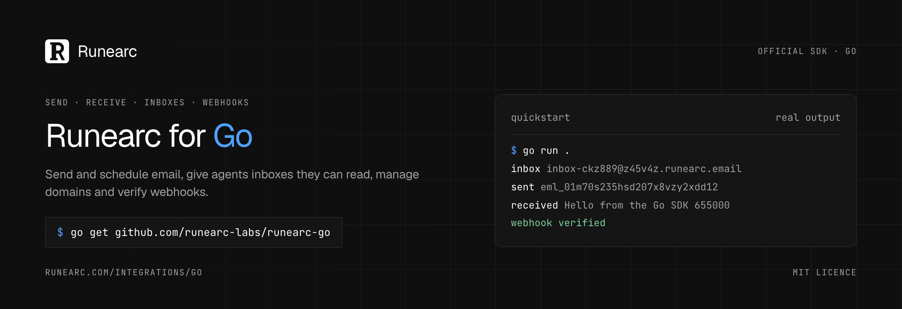

<p align="center">
  <a href="https://runearc.com/integrations/go">
    <picture>
      <source media="(prefers-color-scheme: light)" srcset="https://raw.githubusercontent.com/runearc-labs/runearc-go/main/.github/assets/banner-light.png">
      
    </picture>
  </a>
</p>

<p align="center">
  <a href="https://github.com/runearc-labs/runearc-go/blob/main/CHANGELOG.md"></a> <a href="https://github.com/runearc-labs/runearc-go/blob/main/LICENSE"></a> <a href="https://runearc.com/integrations/go"></a> <a href="https://runearc.com/docs/sdk"></a>
</p>

<p align="center">
  <a href="https://runearc.com"><b>Website</b></a> ·
  <a href="https://runearc.com/docs/sdk">Docs</a> ·
  <a href="https://runearc.com/integrations/go">Go guide</a> ·
  <a href="https://runearc.com/docs/mcp">MCP</a> ·
  <a href="https://runearc.com/status">Status</a> ·
  <a href="https://runearc.com/changelog">Changelog</a>
</p>

# runearc-go

The official Go SDK for [Runearc](https://runearc.com), email infrastructure for apps and AI agents. Send email and give your agents an inbox, from Go.

```sh
go get github.com/runearc-labs/runearc-go
```

```go
client, _ := runearc.New(os.Getenv("RUNEARC_API_KEY"))
sent, err := client.Emails.Send(context.Background(), &runearc.SendEmailRequest{
	From: "Acme <noreply@acme.com>", To: []string{"bob@example.com"},
	Subject: "Welcome to Acme", HTML: "<p>Thanks for signing up.</p>",
})
```

See [runearc.com/integrations/go](https://runearc.com/integrations/go) for the guide and more examples.

The official Go SDK for [Runearc](https://runearc.com): send, batch and schedule email, create inboxes your agents can read, manage domains and verify webhooks.

Standard library only, no dependencies. Go 1.21 or later.

## Install

```sh
go get github.com/runearc-labs/runearc-go
```

```go
import runearc "github.com/runearc-labs/runearc-go"
```

## Quick start

```go
package main

import (
	"context"
	"fmt"
	"log"
	"os"

	runearc "github.com/runearc-labs/runearc-go"
)

func main() {
	client, err := runearc.New(os.Getenv("RUNEARC_API_KEY"))
	if err != nil {
		log.Fatal(err)
	}

	sent, err := client.Emails.Send(context.Background(), &runearc.SendEmailRequest{
		From:    "Acme <noreply@acme.com>",
		To:      []string{"bob@example.com"},
		Subject: "Welcome to Acme",
		HTML:    "<p>Thanks for signing up.</p>",
	})
	if err != nil {
		log.Fatal(err)
	}
	fmt.Println(sent.ID)
}
```

`runearc.New("")` with an empty key reads `RUNEARC_API_KEY`. Options:

| Option | Default | |
|---|---|---|
| `WithBaseURL(url)` | `RUNEARC_BASE_URL`, else `https://api.runearc.com` | A trailing `/v1` is fine. |
| `WithMaxRetries(n)` | `2` | Retries after the first attempt (see [Retries](#retries)). |
| `WithTimeout(d)` | `60s` | Per attempt. |
| `WithHTTPClient(c)` | a new `http.Client` | Bring your own transport. |
| `WithHeader(name, value)` | none | Sent with every request, such as `Runearc-Project`. |

Every method takes a `context.Context` first and returns a typed result and an `error`. Every method also accepts trailing per call options: `WithIdempotencyKey(key)`, `WithRequestTimeout(d)` and, for `Emails.Batch`, `WithBatchValidation(v)`.

Go field names are CamelCase; on the wire they are the API's snake case JSON (`ReplyTo` is `reply_to`, `NextCursor` is `next_cursor`), so the [API reference](https://runearc.com/docs) and this SDK read the same. Optional response values (`null` in JSON) are pointers.

To try things without sending real mail, send to `delivered@test.runearc.com`. `bounced@` and `complained@` at the same domain simulate those outcomes.

## Errors

Methods return a `*runearc.Error` when something fails. Use `errors.As`:

```go
_, err := client.Emails.Send(ctx, &runearc.SendEmailRequest{
	From: "noreply@acme.com", To: []string{"bob@example.com"}, Subject: "Hi", Text: "Hi",
})
var apiErr *runearc.Error
if errors.As(err, &apiErr) {
	fmt.Println(apiErr.Status)  // 403
	fmt.Println(apiErr.Code)    // "sender_not_verified", a stable string to branch on
	fmt.Println(apiErr.Kind)    // runearc.KindForbidden
	fmt.Println(apiErr.Message)
	fmt.Println(apiErr.Fix)     // what to do about it, when there is something to do
}
```

`Error` has `Status` (the HTTP status, or `0` when no response came back), `Code`, `Kind`, `Message`, `Fix` (empty when there is nothing to do), `RetryAfter` (when the API sent `Retry-After`) and, for a refused batch, `Errors`. `Kind` groups errors: `KindInvalid`, `KindUnauthorized`, `KindForbidden`, `KindNotFound`, `KindConflict`, `KindLimitReached` (402), `KindRateLimited`, `KindUnavailable`, `KindInternal` for API errors, and `KindNetwork`, `KindTimeout`, `KindCanceled`, `KindClient` and `KindWebhook` for failures on your side. Failures before a response use the codes `network_error`, `timeout`, `aborted`, `missing_api_key` and `invalid_response`.

`errors.Is(err, context.Canceled)` and `errors.Is(err, context.DeadlineExceeded)` work when the context ended the call, and `Unwrap` returns the underlying network error.

Lists come back as the API sends them: `Data`, plus `NextCursor` on paginated lists.

## Emails

```go
sent, err := client.Emails.Send(ctx, &runearc.SendEmailRequest{
	From:    "Acme <noreply@acme.com>",
	To:      []string{"bob@example.com"},
	Cc:      []string{"carol@example.com"},
	ReplyTo: []string{"support@acme.com"},
	Subject: "Your receipt",
	HTML:    "<p>Thanks for your order.</p>",
	Text:    "Thanks for your order.",
	Attachments: []runearc.EmailAttachmentInput{{Filename: "receipt.pdf", Content: base64Pdf}},
	Tags:    []runearc.Tag{{Name: "kind", Value: "receipt"}},
})

email, err := client.Emails.Get(ctx, sent.ID) // Status, LastEvent, Recipients, Text, ...
page, err := client.Emails.List(ctx, runearc.PageParams{Limit: 50})
next, err := client.Emails.List(ctx, runearc.PageParams{Cursor: *page.NextCursor})
```

### Scheduled send

Set `ScheduledAt` to an RFC 3339 time with an offset, or the relative form `in <n> <unit>`. Up to 30 days ahead.

```go
sent, err := client.Emails.Send(ctx, &runearc.SendEmailRequest{
	From:        "Acme <noreply@acme.com>",
	To:          []string{"bob@example.com"},
	Subject:     "Your trial ends tomorrow",
	Text:        "Here is what happens next.",
	ScheduledAt: time.Now().Add(24 * time.Hour).Format(time.RFC3339), // or "in 1 day"
})

email, err := client.Emails.Get(ctx, sent.ID)                          // Status "scheduled", ScheduledAt set
_, err = client.Emails.Reschedule(ctx, sent.ID, "in 2 days")          // same as Emails.Update
_, err = client.Emails.Cancel(ctx, sent.ID)                            // Status "canceled"
```

Rescheduling or canceling an email that is no longer scheduled fails with `email_not_scheduled` (409).

### Batch send

Up to 100 emails in one request. Each item is a `SendEmailRequest`, `ScheduledAt` included.

```go
res, err := client.Emails.Batch(ctx, []runearc.SendEmailRequest{
	{From: "Acme <noreply@acme.com>", To: []string{"bob@example.com"}, Subject: "Hi Bob", Text: "..."},
	{From: "Acme <noreply@acme.com>", To: []string{"carol@example.com"}, Subject: "Hi Carol", Text: "..."},
})
// res.Data: the ids, in request order
```

By default validation is strict: if any item is invalid nothing is sent, and the error lists every bad item.

```go
var apiErr *runearc.Error
if errors.As(err, &apiErr) && apiErr.Code == "invalid_batch" {
	for _, item := range apiErr.Errors {
		fmt.Println(item.Index, item.Code, item.Message, item.Fix)
	}
}
```

With `WithBatchValidation(runearc.BatchPermissive)` the valid items are sent and the invalid ones are reported in `res.Errors`.

### Senders

```go
senders, err := client.Senders.List(ctx) // addresses you can use as From
```

## Inboxes and messages

Inboxes receive mail. Give one to an agent, wait for a message, read the code in it, reply.

```go
inbox, err := client.Inboxes.Create(ctx, runearc.CreateInboxRequest{LocalPart: "signup-bot", DisplayName: "Signup bot"})
inboxes, err := client.Inboxes.List(ctx)
inbox, err = client.Inboxes.Get(ctx, inbox.ID)

// Wait up to 120 seconds for a matching message. The result is nil when none arrived.
got, err := client.Messages.Wait(ctx, inbox.ID, runearc.WaitParams{From: "github.com", Subject: "verify", Timeout: time.Minute})
if got != nil {
	fmt.Println(got.Codes, got.Links, got.Message.Subject)
}

page, err := client.Messages.List(ctx, inbox.ID, runearc.PageParams{Limit: 20})
message, err := client.Messages.Get(ctx, page.Data[0].ID)
rfc822, err := client.Messages.Raw(ctx, message.ID)

// Send from the inbox, and reply in a thread
_, err = client.Messages.Send(ctx, inbox.ID, &runearc.SendMessageRequest{To: []string{"bob@example.com"}, Subject: "Hello", Text: "Hi Bob"})
_, err = client.Messages.Reply(ctx, message.ID, &runearc.ReplyRequest{Text: "Thanks, on it"})

// Threads
threads, err := client.Threads.List(ctx, inbox.ID)
thread, err := client.Threads.Get(ctx, message.ThreadID) // with Messages

err = client.Inboxes.Delete(ctx, inbox.ID)
```

## Conversations

The shared support inbox view across every inbox you can read.

```go
page, err := client.Conversations.List(ctx, runearc.ConversationFilter{Status: "open", Assignee: "none", Q: "refund"})
counts, err := client.Conversations.Counts(ctx)

id := page.Data[0].ID
_, err = client.Conversations.Update(ctx, id, runearc.ConversationUpdate{Status: "closed"})
_, err = client.Conversations.Update(ctx, id, runearc.ConversationUpdate{SnoozedUntil: runearc.Set(time.Now().Add(time.Hour))})
_, err = client.Conversations.Update(ctx, id, runearc.ConversationUpdate{SnoozedUntil: runearc.Clear[time.Time]()}) // wake
err = client.Conversations.Read(ctx, id)
err = client.Conversations.Unread(ctx, id)
```

In `ConversationUpdate` a nil field is left out of the request, `runearc.Set(v)` sends a value and `runearc.Clear[T]()` sends JSON `null` (unassign or wake).

## Domains

```go
domain, err := client.Domains.Create(ctx, "acme.com")
fmt.Println(domain.Records)  // the DNS records to publish
fmt.Println(domain.NextStep)

checked, err := client.Domains.Verify(ctx, domain.ID) // checks DNS now
list, err := client.Domains.List(ctx)
got, err := client.Domains.Get(ctx, "acme.com")       // id or name
err = client.Domains.Delete(ctx, domain.ID)
```

## Webhooks

```go
hook, err := client.Webhooks.Create(ctx, runearc.CreateWebhookRequest{
	URL:        "https://example.com/hooks/runearc",
	EventTypes: []string{"message.received"}, // empty means every event
})
secret := hook.Secret // whsec_..., shown once: store it

hooks, err := client.Webhooks.List(ctx)
deliveries, err := client.Webhooks.Deliveries(ctx, hook.ID, 20)
_, err = client.Webhooks.Replay(ctx, hook.ID, deliveries.Data[0].ID)
err = client.Webhooks.Delete(ctx, hook.ID)
```

### Verifying webhooks

Runearc signs every delivery with [Standard Webhooks](https://www.standardwebhooks.com): headers `webhook-id`, `webhook-timestamp` and `webhook-signature` (`v1,<base64 HMAC SHA256>`). `VerifyWebhook` checks the signature in constant time, refuses timestamps more than 5 minutes off (set `Tolerance` to change that), accepts several signatures in the header (key rotation) and returns the parsed event. Failures are a `*runearc.Error` with `Kind` `KindWebhook` and a code: `missing_headers`, `invalid_timestamp`, `timestamp_out_of_range`, `invalid_secret`, `invalid_signature` or `invalid_payload`. Always pass the raw body, not JSON you decoded and encoded again.

```go
http.HandleFunc("/runearc", func(w http.ResponseWriter, r *http.Request) {
	payload, err := io.ReadAll(r.Body)
	if err != nil {
		http.Error(w, "unreadable body", http.StatusBadRequest)
		return
	}
	event, err := runearc.VerifyWebhook(runearc.VerifyWebhookInput{
		Payload: payload,
		Headers: r.Header,
		Secret:  os.Getenv("RUNEARC_WEBHOOK_SECRET"),
	})
	if err != nil {
		http.Error(w, err.Error(), http.StatusBadRequest)
		return
	}
	if event.Type == "message.received" {
		var data struct {
			MessageID string `json:"message_id"`
			InboxID   string `json:"inbox_id"`
		}
		_ = json.Unmarshal(event.Data, &data)
	}
	// event.ID is the webhook-id: use it to drop duplicates.
	w.WriteHeader(http.StatusNoContent)
})
```

`client.Webhooks.Verify` is the same function.

## API keys, suppressions and events

```go
created, err := client.Keys.Create(ctx, runearc.CreateKeyRequest{Name: "app", Permissions: "sending", DomainID: "acme.com"})
secret := created.Secret // shown once
keys, err := client.Keys.List(ctx)
err = client.Keys.Delete(ctx, created.Key.ID) // revokes at once

suppressed, err := client.Suppressions.List(ctx)
err = client.Suppressions.Delete(ctx, "bob@example.com") // lets mail go to bob again

page, err := client.Events.List(ctx, runearc.EventsParams{Limit: 100}) // oldest first
page, err = client.Events.List(ctx, runearc.EventsParams{After: *page.NextAfter})
```

## Retries

A request is retried up to `WithMaxRetries` times (default 2) with exponential backoff and jitter (500 ms doubling up to 8 s), and waits as long as the API's `Retry-After` header asks (seconds or an HTTP date, at most 60 s). It retries:

* 429 (rate limited), always;
* 5xx, network errors and timeouts, when the request is safe to repeat: GET, PATCH and DELETE, and any POST that carries an `Idempotency-Key`. Cancel, verify and mark read are repeated too.

It never retries other 4xx errors. A POST that could create something twice (such as creating an inbox) is not repeated after a 5xx or a network error; the error is returned instead. Canceling the context stops the call and any wait between attempts at once.

## Idempotency

Every call that sends mail (`Emails.Send`, `Emails.Batch`, `Messages.Send`, `Messages.Reply`) gets a random `Idempotency-Key` when you do not give one, and every retry reuses it, so a retry never sends twice. Runearc remembers keys for 24 hours. To make your own retries safe too, for example from a job queue, pass a key that is stable for that piece of work:

```go
client.Emails.Send(ctx, email, runearc.WithIdempotencyKey("welcome/"+user.ID))
```

Repeating a key with the same body returns the first result. The same key with a different body fails with `idempotency_conflict` (409).

## Tests

The tests run against a real API and worker on a throwaway Postgres database; nothing in the mail path is mocked. They need Postgres on localhost (`createdb`, `dropdb` and `psql` on `PATH`) and the Rust binaries `runearc-api` and `runearc-worker` in `target/agent-sdk/debug` of the repository, or in `RUNEARC_BIN_DIR`:

```sh
go test ./... -race
```

## License

MIT. Copyright Runearc. See [LICENSE](LICENSE).
